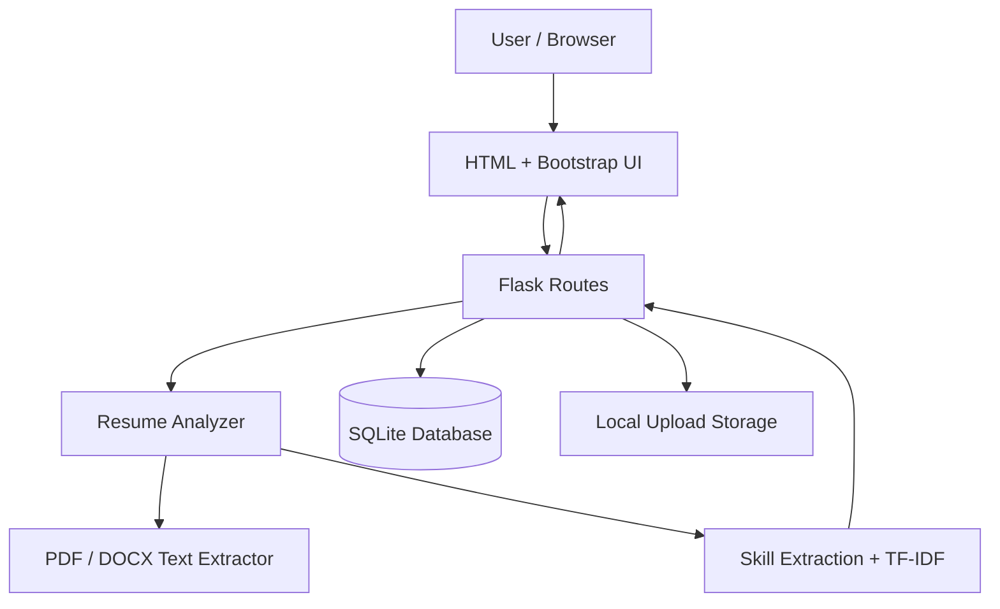
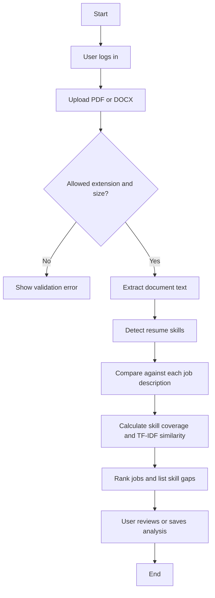
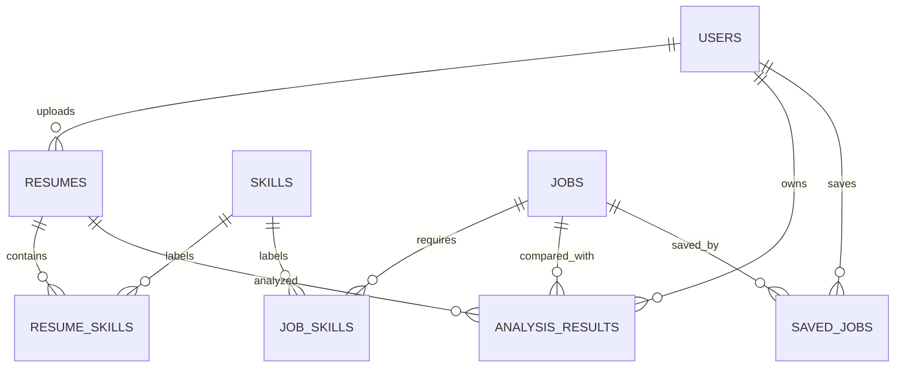
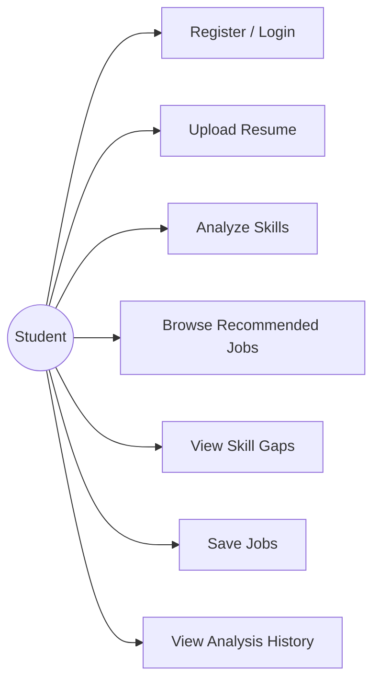

# System Diagrams

These Mermaid diagrams can be pasted into a Mermaid-compatible editor or included as figures in the report.

## 1. System architecture

## 2. Resume analysis flow

## 3. Entity relationships

## 4. Use-case overview

